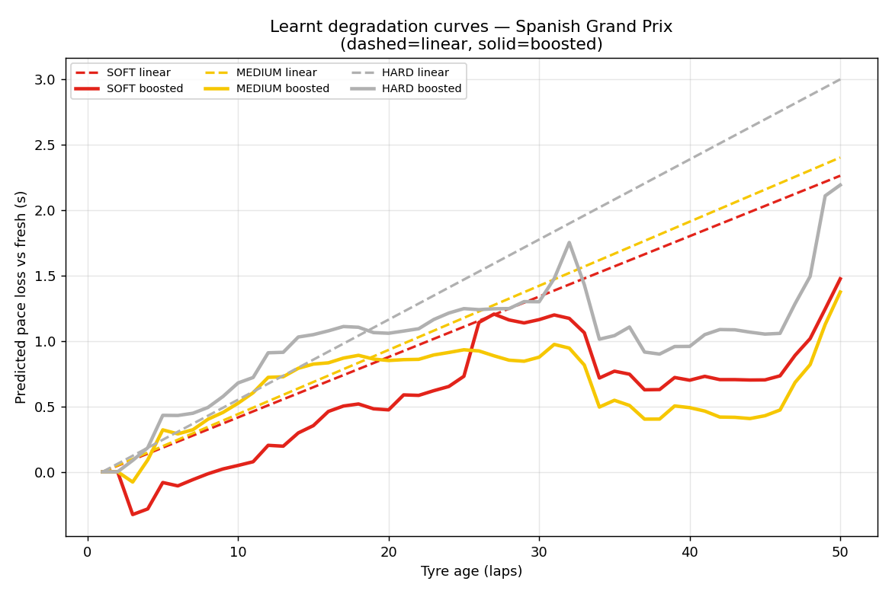
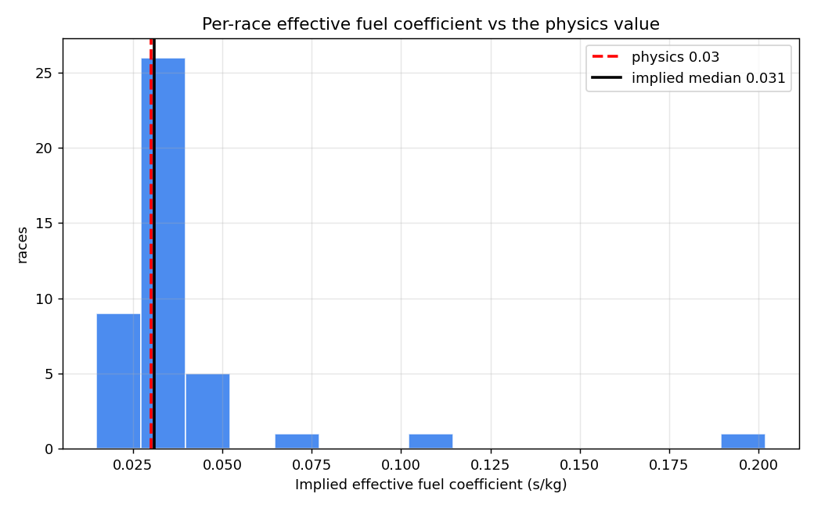
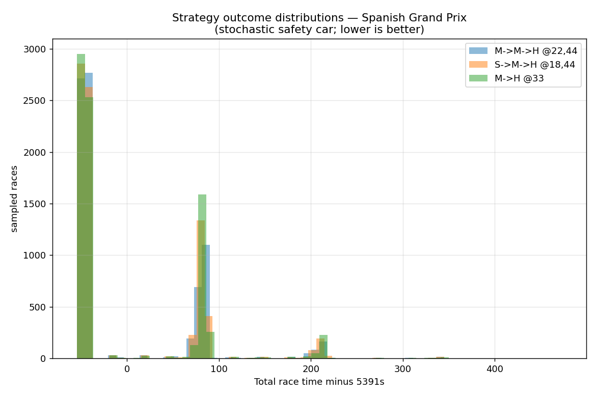
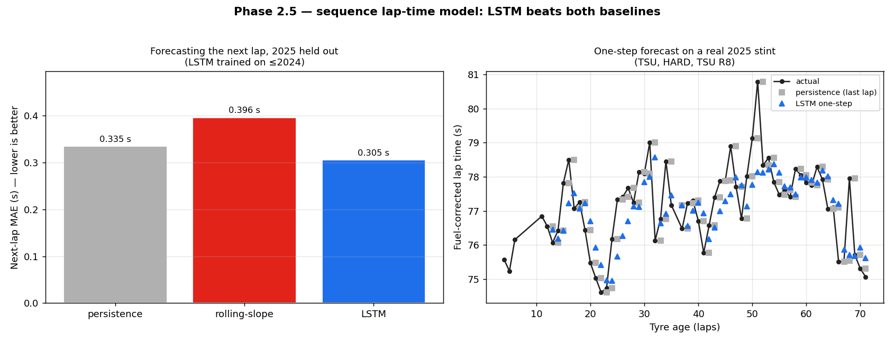

# Methodology — how every number was earned

This project's claim is not "the model is accurate"; it's that **every number is
either calibrated from data or explicitly labelled as an assumption** — and the
models that failed to earn their place are documented rather than deleted. This
page is the evidence. Each section is reproducible from a script in
[`analysis/`](../analysis/).

---

## 1. Validation that can't cheat

Laps within a race are near-duplicates (same car, track, weather, fuel run). A
shuffled train/test split puts lap 30 of a race in training and lap 31 in test,
and every score inflates. All evaluation here uses two splits instead
([`f1se/validation.py`](../src/f1se/validation.py), tested):

- **GroupKFold by race** — no race ever spans train and test;
- **forward-in-time holdout** — train on past seasons, test on a future one.

This discipline caught a real bug immediately: the first degradation model
predicted *absolute* lap time and scored 0.69s MAE in-sample — but **7.5s on
held-out races**, because base pace is track-specific and an unseen track has no
intercept. The fix (predict *within-stint pace loss*, leaving base pace to the
simulator) is what generalises: 0.40s on races the model never saw.

## 2. XGBoost lost to a straight line — and why that's the right answer

Identical leakage-safe folds, identical within-stint target, identical metric:

| Model | Pace-loss MAE, held-out races |
|---|---|
| Naive (no degradation) | 0.526 s |
| **Linear per (track, compound)** | **0.404 s** |
| XGBoost | 0.422 s |

The learnt-curve plot shows why: the boosted model tracks the line where data is
dense (tyre age ≤ ~30 laps), then chases noise in sparse, confounded late-stint
laps. Degradation is ~linear in the observed range, so added flexibility buys
variance, not signal. A synthetic test with genuinely curved degradation confirms
the comparison *can* detect curvature when it exists — there just isn't any here.

*Reproduce: `analysis/phase2_boosted.py`*

## 3. The tyre "cliff" is censored out of every public dataset

Teams pit before tyres fall off the cliff, so race data — anyone's race data —
contains almost no cliff laps. Fitting a quadratic anyway makes the model
**worse** on the forward holdout (0.497 vs 0.484 MAE) and produces physically
backwards curvature (hards come out *concave*). Practice sessions don't rescue
it: their long runs are no longer than race stints, and fuel loads are unknown.

So the cliff ships as an explicit, tunable **physical prior**
([`models/cliff.py`](../src/f1se/models/cliff.py)) — extra pace loss beyond a
per-compound onset age — with the same epistemic status as the fuel coefficient:
an assumption, labelled, adjustable, never presented as a measurement. Paired
with data-driven per-compound stint-length caps, it shifted the Spanish GP
recommendation from a 42-soft-lap plan to an 18-soft-lap plan whose soft stint
ends exactly at the cliff onset — the realistic behaviour.

*Reproduce: `analysis/phase2_forward.py` (quadratic test), `analysis/phase4_optimize.py` (effect on strategy)*

## 4. The fuel assumption survived its audit

Fuel burn makes every lap faster as the race runs, masking tyre degradation. The
correction assumes **0.03 s of lap time per kg of fuel** — a rule of thumb worth
auditing, since the measured degradation slope roughly *doubles* across the
plausible β range. Two checks:

1. **Sensitivity is analytic**: within a stint, the corrected slope shifts by
   exactly Δβ · (fuel burned per lap) ≈ Δβ · 1.69 — verified empirically, so the
   assumption's influence is known, not vague.
2. **Calibration**: backing an *effective* coefficient out of the net race-lap
   pace trend (identified from pit-stop pace jumps, where tyre age resets but
   fuel keeps falling) across 43 races gives **median β = 0.031** — right on the
   physics value. The per-race spread is wide (evolution and lift-and-coast
   confound any single race), so only the pooled median is trusted.

*Reproduce: `analysis/phase1_eda.py` (sensitivity), `analysis/phase2_calibrate.py` (calibration)*

## 5. A decomposition that didn't work — kept as a diagnostic

An attempt to separate *track evolution* (grip improving as the circuit rubbers
in) from degradation failed honestly: a linear-in-lap evolution term is
**collinear with the fuel correction** (fuel mass is also linear in lap), so the
fitted "evolution" absorbed fuel miscalibration and late-race management instead
— coming out *positive* (pace fading), the opposite of rubber-in. The module
survives as a documented diagnostic of the net lap-trend, not as a correction.
The lesson generalised: for this data, the within-stint bundled estimate is the
*right* predictive object for a strategy simulator anyway.

*Reproduce: `analysis/phase2_evolution.py`*

## 6. Safety cars and pit loss are measured, not assumed

Safety cars dominate outcome uncertainty — the race-time distribution is
multi-modal, with clusters ~2 minutes apart corresponding to 0/1/2 SC periods:

The hazard model is therefore calibrated from **86 races** of per-lap
track-status data — every race in `track_status.parquet`, refitted at engine
start rather than baked in, so it tracks the dataset: **0.0108 SC triggers per
lap, mean duration 5.0 laps** (the literature default of 0.013/4 was close). The
real gain is **per-circuit** rates with
partial pooling — Australia/Canada/Qatar average ~1.5 SC periods per race while
Spain had zero in 2023–24, and shrinkage keeps the zero-observation tracks at a
sensible non-zero hazard. The same treatment gives per-circuit pit loss from
in/out-lap deltas (Spa 19.0s … Spain 23.4s … Singapore 29.4s — matching the
known pit-lane geometry).

*Reproduce: `analysis/phase3_sc_calibrate.py`*

## 7. 2026: modelling across a regulation reset

2026 rewrote the cars, so pre-2026 models are biased and 2026 data is scarce —
a textbook bias–variance trade resolved component-wise:

- **Transferable components** (pit-lane loss, SC hazard, fuel physics) pool all
  seasons.
- **Regime-sensitive components** (base pace, degradation) use a **shrinkage
  estimator**: each per-group slope is a precision-weighted blend of the 2026
  estimate and the pre-2026 prior, converging to 2026 truth as races accumulate.

Measured on real 2026 laps (11 races), the regime shift is large and the fix
works — but by much less than this table originally claimed:

| Degradation model | Pace-loss MAE on 2026 laps | vs naive |
|---|---|---|
| Naive (no degradation) | 0.573 s | — |
| Pre-2026 (old cars) | 0.495 s | **+13.6%** |
| Shrunk — *scored on races it was fitted on* | 0.432 s | +24.6% ✗ |
| **Shrunk — leave-one-race-out** | **0.490 s** | **+14.4%** |

**The correction.** The first version of this section reported the third row as
the result. It is in-sample: `fit_era_shrunk_degradation` was fitted on the full
lap set — 2026 races included — and then scored on those same 2026 laps, while
the prior it was compared against saw none of them. An in-sample model against
an out-of-sample baseline is not a fair fight, and §1 of this document exists to
prevent exactly that. Caught at round 11 while re-running the numbers on more
data; the sweep in §13 is what exposed it.

Re-scored leave-one-race-out — fit on every 2026 race except the one being
measured — the in-sample figure is **13.5% optimistic**, and shrinkage's real
margin over simply using the old-car prior is **+1.0%** on the mean. That mean
is dragged by one bad race (round 2, where the prior is much better); shrinkage
is the better model in **8 of 11** races. So the honest summary is *consistently
but modestly better*, not the step-change originally advertised.

The regime shift itself is unaffected and remains the real finding: 2026 slopes
differ sharply from pre-2026 (HARD roughly doubles, +0.034 → +0.059 s/lap), so a
2026-aware model is still the right call — the argument for it is that it tracks
a genuinely different regime, not that it posts a big MAE win.

The championship projection applies the same humility: with only a handful of
2026 rounds, each simulation **bootstraps driver strength** from the races seen
so far, so a dominant leader shows ~99% — not a dishonest 100% — and close form
yields genuinely open odds.

*Reproduce: `analysis/phase_2026_shrinkage_honest.py` (the fair comparison);
`analysis/phase_2026_validation.py` prints the in-sample figure and now labels it
as such.*

## 8. The one time complexity won — a sequence model for next-lap pace

Everywhere else the simpler model won. So the head-to-head framework owed the
deep-learning option the same fair shot — and here it took it. The task is
**one-step-ahead forecasting**: standing at lap *t* of a stint, predict lap
*t+1*'s fuel-corrected time. An LSTM reads the recent run of laps; to stop it
memorising track base pace (the same leakage trap §1 caught), it predicts the
lap-to-lap **delta** Δ = pace[t+1] − pace[t], so the per-stint level cancels and
it can only win by predicting *change*.

Forward-in-time, train ≤2024, test on 2025 (2026 excluded — regime reset):

| Next-lap predictor | MAE on held-out 2025 laps |
|---|---|
| Rolling-slope (extrapolate local trend) | 0.396 s |
| Persistence (next lap = last lap) | 0.335 s |
| **LSTM (sequence → delta)** | **0.306 s** (±0.001 over 3 seeds) |

The LSTM beats the dumb baseline by **~8.5%** — small but real and reproducible.

**Restated on eleven unseen races.** The model never sees 2026 at all, so every
2026 race is a genuine unseen test. Round 11 made it eleven of them, which is
enough to replace a single number with a distribution:

| Improvement vs persistence, 2026 | |
|---|---|
| Mean / median | **+13.4% / +13.3%** |
| Spread (sd 3.7) | +8.0% … +18.6% |
| **Races beaten** | **11 / 11** |
| vs rolling-slope baseline | +25.0%, also **11 / 11** |
| Pooled over 7,352 windows | +13.6% |

This corrects the advertised figure in both directions at once. The **+18%**
this document previously quoted from the Austrian GP (§9) turns out to be the
**best of the eleven**, not a typical one — a single race was always going to be
whatever it was, and it happened to flatter. The honest headline is **+13.4%**.

### Retraining on 2025 was tested too, and bought nothing

The shipped forecaster trains on <= 2024. Folding in 2025 -- a whole season
currently used only for scoring -- looks like free accuracy. Training on 2026 was
never on the table: those are the races the claim is measured on.

Same held-out 2026 either way, both models fitted identically, differing only in
training data (30,063 -> 45,425 windows, **+51%**):

| | Mean vs persistence | Mean MAE | Beats persistence |
|---|---|---|---|
| A, train <= 2024 | +12.9% | 0.3673 | 11 / 11 |
| B, train <= 2025 | +12.9% | **0.3673** | 11 / 11 |

**+0.00%.** B is better in 5 of 11 races -- a coin flip. Half again as much data
moves the fourth decimal place, which says the model is capacity-limited, not
data-limited; more sequences of the same kind teach it nothing new.

**Rejected.** Training stays at <= 2024, which keeps 2025 as an independent
holdout *and* 2026 as the unseen test. Giving up a holdout season for nothing
would be a poor trade.

(Both models here are fresh fits without the race-grouped validation split the
shipped artifact uses, so A scores +12.9% where the exported model scores +13.4%.
The A-vs-B comparison is unaffected -- they differ only in training years.)

But the claim gets *stronger* where it counts: winning 11 of 11 unseen races
with a 3.7-point spread is a far better argument than one impressive race,
because it can't be luck. This is the difference between "the model beat a
baseline once" and "the model beats the baseline."
Two honest readings come with it. First, the *rolling-slope* baseline is **worse
than persistence**: at a one-lap horizon, fuel-corrected pace is close to a random
walk, so naively projecting a 5-lap slope just amplifies per-lap noise — a useful
reminder that "more model" can hurt even among baselines. Second, the LSTM's edge
is exactly that it **damps the noise persistence copies** and anticipates tyre
warm-up and settling: in the figure it predicts *below* the lap-51 spike instead
of chasing it.

The same leakage discipline applied to the model's own inputs. An early draft fed
a "stint fraction" feature = tyre age ÷ *the stint's final age* — which silently
leaks how long the stint will end up being (i.e. when the team pits, a future
decision). It was removed; the result barely moved (0.305 → 0.306), confirming
the edge came from the genuine lap-to-lap sequence, not from peeking ahead.

Scope, stated plainly: this is a *nowcasting* gain on raw next-lap pace, **not** a
replacement for the degradation model in the strategy simulator — the simulator
needs a full-stint pace curve as a function of tyre age, which the within-stint
fixed-effects model supplies directly, not a one-step autoregressor seeded by
recent laps. It's surfaced where it belongs: the **Live Race tab's next-lap
nowcast**. To keep that deployable on a torch-free host, the trained network is
exported to a 28 KB numpy weights file and its LSTM forward pass re-implemented in
numpy (a parity test pins the two to within 1e-6), so the live app ships the model
without the heavy dependency.

*Reproduce: `analysis/phase2_5_sequence.py`*

## 9. The real test: a race the models had never seen (Austrian GP 2026)

Held-out *seasons* are one thing; a brand-new race is the honest one. The Austrian
GP 2026 is in **none** of the committed data, so it's a clean out-of-sample check
of the whole build at once — pulled from FastF1 and compared to what actually
happened (winner **RUS**, from a medium → hard → hard 2-stop).

| Check | Result |
|---|---|
| **Strategy — race shape** | **hit** — engine got 71 laps and a **2-stop** (15 of 19 finishers 2-stopped) |
| **Strategy — compound pick** | **miss** — engine's compounds differed from the winner's |
| **LSTM nowcast** | **hit** — **+18.2%** vs persistence (0.31 vs 0.38 s). Re-measured across all 11 unseen 2026 races (§8), this is the **best** of the eleven, not a typical one; the mean is +13.4% |
| **Podium model** | **hit** — **2/3** correct (RUS, ANT) vs the grid baseline's **1/3** |
| **Degradation** | ~ right ballpark, but slopes ran gentle (model MEDIUM 0.081 vs actual 0.097 s/lap) |

The strategy compound miss traced straight to the degradation under-estimate:
the model thought the mediums were more durable than they were, so it over-valued
running them. That exposed a real gap — a track raced in 2023–25 but not yet in
2026 kept its **stale pre-reset slope**, ignoring the regulation change entirely.

**The fix (regime- and recency-aware degradation).** Two changes, both principled:
recency-weight the target-era estimate (recent races weigh more, so mid-season
**car upgrades** propagate in 1–2 races instead of being averaged flat), and
propagate the compound-level 2026 era shift onto tracks not yet run in 2026. After
this, Austria's slopes moved measurably closer to the truth on all three compounds.

**The twist that validated it.** The updated model then recommended a **soft**
middle stint — which looked wrong (the field avoided softs) until the data was
actually checked: soft degradation at Austria was the **lowest** of the three
(0.060 vs medium 0.097, hard 0.088 s/lap), over 130 laps and 7 drivers. The
model's soft lean was a *real* signal, not noise — and it matched a driver's
post-race comment that the softs were quick and the teams didn't commit to them.
Honest caveat: the winner still won on hards, so softs were a genuine *underused
option*, not proven optimal — exactly the kind of edge a strategy tool should
surface for humans to weigh.

*Reproduce: `analysis/backtest_austria_2026.py` (network — pulls the race from FastF1)*

**Extended to the whole 2026 season (leave-one-race-out).** Across all 8 completed
2026 rounds, each race is predicted by a model **refit without that race**, so every
check is out-of-sample. Degradation is close (**0.07 s/lap MAE**), and the engine
matched the field-dominant stop-count on **4/8** races. The misses are *systematic
and explainable*, not random: at durable-tyre circuits where the field one-stops to
hold track position (Japan: **21 of 22 drivers one-stopped**), the engine's free-air
*time*-optimal plan recommends an extra stop — because it models pace and degradation
but **not overtaking cost / track position**. It matches where the field genuinely
two-stopped (Monaco, Austria). A clean, honest boundary of a free-air strategy model.

That boundary prompted a fix — and the fix is itself a lesson in validating a
hypothesis. The intuition was "add a track-position penalty so the optimiser
stops over-stopping at processional circuits." But the **data refused the
hypothesis**: the over-stopping is mostly at *easy*-to-overtake circuits
(Australia/China/Canada shuffle their grid the most), while the engine already
agrees where overtaking is genuinely hard. So a difficulty-scaled penalty targets
the wrong tracks. What shipped is an [`OvertakingPrior`](../src/f1se/models/overtaking.py)
— a labelled, tunable per-stop cost (mostly uniform: the out-lap, traffic, and
execution cost the free-air sim omits; plus a *small* term that grows with
data-derived overtaking difficulty). It cleanly fixes the one textbook case
(Suzuka), but honestly it's a **nudge, not a cure**: the bulk of the over-stopping
is a pace/degradation-calibration matter, not track position, and pushing the
prior harder just under-stops genuine high-degradation two-stop tracks. Kept on by
default, documented for exactly what it does and doesn't do.

**Then the real cause: weather.** Digging past the track-position red herring, the
model's per-race degradation error lined up cleanly with **track temperature** — it
*over*-predicts wear on a cool day (China 23 °C, Canada 18 °C) and *under*-predicts
on a hot one (Barcelona 50 °C), because the pooled fit assumes an average
temperature. That mis-estimate is what made the optimiser over-stop at cool races
and under-rate the genuine multi-stop at hot ones. The fix is a
[`ThermalPrior`](../src/f1se/models/thermal.py) that shifts the degradation slope
with track temperature (direction is physics, magnitude data-informed — a labelled
prior, like the cliff). Feeding each race its real temperature lifted the
field-dominant stop-count match from **4/8 to 7/8** (and 3/8 → 6/8 vs the winner) —
and, satisfyingly, *undid* the Barcelona regression the overtaking prior had caused.
It's a live control in the app: an **expected-track-temp slider** on the Strategy
tab — cooler ⇒ fewer stops, hotter ⇒ more. Canada (coldest, but genuinely
tyre-punishing) is the one honest miss that remains.

*Reproduce: `analysis/backtest_2026_season.py` (uses each race's FastF1 track temp)*

## 10. From engine to F1 OS — the same validated pieces, resurfaced

The app later grew from four strategy views into a nine-section **F1 OS**
(standings, race hub, driver/team profiles, calendar, news). Methodologically,
almost nothing new was modelled — the point was to *reuse* the validated pieces
where people actually look:

- **Standings** attach a title-win probability per driver from the same
  bootstrap championship simulator (§7's honesty device: a few-race leader
  shows ~90%, not a dishonest 100%).
- **The Race Hub** turns §9's discipline into a product feature: for any race,
  the podium model's **pre-race** prediction (trained only on earlier seasons)
  is shown next to the actual result and scored **hit@3** — every race card is
  a small forward test on display, misses included.
- **The Calendar** surfaces the next-race podium prediction where people check
  the schedule, and says plainly that the grid defaults to qualifying form
  until the real grid exists.
- **News** is headlines + link-out only (RSS); **live timing** was deliberately
  *not* faked: real-time data only streams during a session, so between
  sessions the calendar counts down and the Live Race view replays — the UI
  says so instead of pretending.

Two data-honesty items surfaced during the build and were fixed rather than
papered over: an all-NaN 2021 results ingest (dropped — the window is
2023–2026 and now says so), and profile "career" totals that were really
window totals (relabelled **"2023–26 totals · not all-time career"**).

## 11. Compound censoring: when the absence of data is the data (British GP 2026)

A user-caught failure, and the best kind: at Silverstone the engine recommended
**soft-heavy plans (M→S→S / S→S→M) under every objective and temperature — and
the field's near-universal strategy wasn't even in the top-10 shortlist**.

**Diagnosis.** The fitted model claimed all three compounds degrade almost
identically at Silverstone (~0.053–0.059 s/lap). But only **13 soft laps exist
there in all of 2026** (longest stint 13, most just 1–3 laps): the field avoids
the compound, so the "fit" is really the era-shrinkage falling back to the
2023–25 prior — old cars that *didn't* chew softs there. The one measurable 2026
soft stint says **0.16 s/lap, ~3× the fitted value**. Worse, the few laps that
do exist are end-of-race dashes on an evolved track, so the fitted soft *base
pace* showed +1.35 s/lap advantage over mediums — where the old era, with real
soft running, measured softs 0.38 s **slower**. Every fitted quantity for the
avoided compound was fiction, each wrong in the direction that flatters it.
This is §3's censoring problem one level up: there, teams pit before the cliff
so it can't be fitted; here, teams avoid a whole compound so *nothing* about it
can be fitted — and the avoidance itself is the missing evidence. (It also
can't be patched globally: pooled 2026 soft degradation looks *gentler* than
hard's for the same reason — softs only ever appear in short fresh dashes.)

**The fix — an [`AvoidancePrior`](../src/f1se/models/censoring.py), three
labelled parts:**

1. **Stint caps**: where the era's field ran a compound only in short stints
   (≥2 stints, all under 15 laps), the optimiser may not plan that compound
   longer than the longest demonstrated stint (+2). No number is invented —
   plans are constrained to the support of the data.
2. **Slope un-shrinkage**: for those avoided groups the era blend toward the
   old-regs prior is affirmatively wrong (the avoidance corroborates the noisy
   direct estimate), so the raw era slope is used when it's *worse*. Never
   lowers a slope.
3. **Base re-anchoring**: the avoided compound's base pace is rebuilt as the
   era's best-supported compound at that track plus the **old era's measured
   gap** between the two — compound offsets are far more stable across a reg
   change than absolute levels.

Deliberately surgical: across all of 2026 it triggers at exactly **two**
(track, compound) pairs — Silverstone softs and China softs. Austria's softs,
whose low degradation was *supported* by 130 real laps (§9), are untouched.

**Result.** Silverstone recommendations flip from fantasy-soft to **M→H /
H→M** under every objective — the field's actual core compounds. The
leave-one-race-out season backtest (now 9 races, censoring recomputed per fold
so the held-out race's own avoidance can't leak) holds: **7/9 vs winner, 8/9 vs
field-dominant**, degradation MAE 0.069 s/lap.

**The twist that reframed the "miss".** The model still preferred a 1-stop
M→H while the classified results show most drivers making a late stop for
softs. The track status log explains it: a **safety car from lap 47 to the
flag** (and a VSC around lap 38). The field's soft dash was an opportunistic
near-free stop behind the SC — not a plannable strategy, and exactly the
scenario the simulator prices as a *random* hazard rather than a plan. The
winner's green-flag strategy shape matches the engine's call. Honest boundary,
same as ever: the engine optimises the plan you can commit to before the
lights; it cannot — and should not — pre-book a safety car.

## 12. Letting the model train on the season it predicts — rejected, and a tie admitted

By round 11 the 2026 book held 220 result rows, so an obvious question opened
up: the live next-race call trains on `year < 2026` and has therefore **never
seen a 2026 race**. After a regulation reset, those are the only rows drawn from
the current regime. Surely using them helps?

Two jobs were separated to test it. *Reporting* must never see the season it is
scored on, or the advertised AUC is worthless — that stays. *Deployment* only
has to predict the next race, and could legitimately learn from rounds already
run. The test is walk-forward, which is what deployment actually looks like: to
predict round *r*, train on pre-2026 **plus 2026 rounds < r**, never on *r* or
anything after it.

| Model (11 races, mean hit@3 of 3) | Score |
|---|---|
| Reporting — never sees 2026 | **1.73** |
| Deployment — walk-forward on 2026 | 1.64 |
| Naive grid baseline | **1.73** |

Pooled ROC-AUC was identical to four decimals (0.9295 vs 0.9294). Per race the
deployment model was better in **0**, worse in **1**, and identical in **10**.
**Rejected** — 220 rows of a new regime don't outweigh 1,398 rows of learned
grid→podium structure, and that structure transfers better across the reset than
base pace does (§7), because it encodes *how much starting position matters*
rather than *who is fast*.

The same table forces a second admission. Over 2026 the podium model's
precision@3 is **0.5758** — and the naive grid baseline's is **0.5758**. Exactly
equal. The model ranks the full field well (AUC 0.93, and it beat the grid on
2024–25), but **on this season it adds nothing to picking the top three**. The
2026 grid has been unusually predictive; a season where the front row converts
is a season where "read the grid" is hard to beat. Both numbers are published
rather than the flattering one alone.

*Reproduce: `analysis/phase_2026_deployment_model.py`*

## 13. Tuning the shrinkage constant — and what the flat curve gave away

`k` (`shrinkage_laps = 150`) sets how hard each 2026 slope is pulled toward the
pre-2026 prior: `(n·est + k·prior)/(n + k)`. It was a prior-strength *guess* made
when 2026 had two races and there was no honest way to tune it. Eleven races is
enough to stop guessing, so it was swept leave-one-race-out.

| k | LORO MAE | | k | LORO MAE |
|---|---|---|---|---|
| 0 (2026 only) | 0.4907 | | 250 | 0.4898 |
| 25 | 0.4906 | | 400 | 0.4895 |
| 50 | 0.4905 | | 800 | 0.4887 |
| 100 | 0.4903 | | 2000 (ignore 2026) | **0.4879** |
| **150 (current)** | **0.4901** | | | |

Two results, and the second matters more than the first.

**The curve is flat.** Across a range where `k=0` trusts 2026 alone and `k=2000`
effectively ignores it, MAE moves 0.57% end to end. `k` is not a lever worth
tuning — **left at 150**, since re-tuning to chase 0.45% would be fitting noise,
and the whole grid is inside the spread between individual races.

**It also slopes the wrong way.** If shrinkage were adding real signal, error
should rise as `k` grows and 2026 data is discounted. It falls, monotonically.
That is what prompted the check in §7 — and confirmed the published gain was
in-sample. A flat curve pointing the wrong direction is a smell worth chasing;
had `k` been re-tuned to 2000 on this table alone, the leak would have been
quietly buried under a "tuned hyperparameter" instead of found.

*Reproduce: `analysis/phase_2026_shrinkage_sweep.py`*

### Per-compound k — rejected, and the reason is the interesting part

§13 left one thread open: 2026 lap counts differ sharply by compound (HARD
4,915, MEDIUM 3,830, SOFT 1,354), so in principle each deserves its own prior
weight — a compound with plenty of evidence should lean on the prior less.
Swept the same way, leave-one-race-out, over a 3x3x3 grid.

| | LORO MAE |
|---|---|
| Global k=150 | 0.4901 |
| Best per-compound | **0.4878** (+0.48%) |
| Spread across all 27 combinations | 0.4878 .. 0.4916 (**0.78%**) |

The gain is *smaller than the spread of the grid it was found in*. Three free
parameters searching 27 combinations will beat a single value almost by
construction, and 0.48% is what that costs.

The decisive detail is not the size though — it is the direction. The winning
setting is : lean hardest on the pre-2026 prior
for HARD, the compound with **the most** 2026 evidence, and trust 2026 most for
MEDIUM. That is backwards from the entire rationale for splitting k. A result
that contradicts its own mechanism is fitting noise, whatever its MAE says.

**Rejected.** k stays global at 150.  now accepts a
per-compound mapping anyway, because the experiment needed it and a future
season with more data may revisit the question — but nothing passes one.

## 14. The "transferable" half of §7, finally measured

§7 splits the engine in two: regime-sensitive components get shrinkage,
transferable ones (pit loss, SC hazard, fuel physics) pool every season. The
argument for pooling the safety car is that it belongs to circuits and
marshalling rather than to cars. Reasonable — and, until now, **assumed**. It is
also not a harmless assumption: SC probability sets when the simulator expects a
cheap stop, so it moves the strategy call directly.

Eleven races of 2026 track status is enough to check. Whole races are
bootstrapped (10,000 resamples) so "different" has to clear small-sample noise:

| | SC periods | Laps | Per-lap hazard | 95% CI |
|---|---|---|---|---|
| pre-2026 (70 races) | 46 | 4,213 | 0.01092 | [0.00797, 0.01405] |
| 2026 (11 races) | 6 | 673 | 0.00892 | [0.00416, 0.01445] |

2026 runs 18% lower as a point estimate — 0.55 SC periods per race against 0.66
— but the intervals overlap almost entirely. Six SC periods simply cannot
separate themselves from the pooled rate. **The assumption holds**: pooling the
hazard across the reset is now supported by data rather than by argument.

Worth stating plainly, because it is the weaker kind of result: this is a
*failure to detect a difference*, not proof of no difference. The 2026 interval
is wide enough to accommodate a real ±40% shift. It should be re-run at
season's end, when 23 races will roughly halve that interval.

### The bigger hole this uncovered: the VSC is invisible

The table above counts what the engine counts, and the engine counts track
status `4` — a **full** safety car — and nothing else. A *virtual* safety car
(`6`/`7`) also neutralises a race and also makes a stop cheaper, and it turns
out to be at least as common:

| 2026 | Periods | Per-lap hazard |
|---|---|---|
| Safety car only — what the engine models | 6 | 0.00892 |
| **Safety car + VSC — what actually neutralises a race** | **20** | **0.02972** |

**The engine sees 6 of 20 neutralisations — 30%.** Worse, **5 of the 11 races
had no full SC but did have a VSC**, so the simulator treats them as completely
event-free when in fact a cheap-stop window opened. Pre-2026 the same gap exists
but is milder (46 → 73, +59%), which means it is not even a constant bias — it
has grown under the new regulations.

Re-running the transferability test on the VSC-inclusive rate keeps the same
verdict, but far more marginally: 2026 at 0.02972 [0.02102, 0.04032] against
pre-2026's 0.01733 [0.01351, 0.02135] — a **+71.5%** point difference with
intervals that barely touch. The conclusion above survives; it is much thinner
than the safety-car-only numbers make it look.

**Why widening the match to `4|6|7` would be the wrong fix.** The simulator
prices a stop under neutralisation at `pit_loss_sc_s = 11.0` against a full
green-flag loss — roughly half. That discount is earned by the field *bunching*
behind a safety car. Under a VSC everyone is slowed against a delta and the pack
never closes up, so a VSC stop saves real time but distinctly less. Lumping them
would trade a known under-count for an unknown over-credit.

### The three-state fix

The engine now models **green / VSC / full SC** as distinct states, with tiers
taken from the regulations and reported practice rather than invented:

| State | Lap-time factor | Pit loss | Why |
|---|---|---|---|
| Green | 1.00 | ~21 s (measured per track) | — |
| **VSC** | **1.35** | **16 s** | field slowed, never bunches (reported 15–18 s) |
| Full SC | 1.40 | 11 s | field bunches behind the pace car (12–14 s) |

`SafetyCarModel` carries a second hazard calibrated from VSC-only laps (SC laps
excluded, so a race escalating VSC → SC isn't double-counted), and
`sample_states` returns `0/1/2` with the full SC winning any overlap. Both
hazards are shrunk per circuit on the same footing — that mattered, because the
engine uses the *per-track* models, so calibrating only the global one would
have confined the fix to a fallback path.

Measured on all 81 races available at round 11: SC 0.01064/lap, VSC 0.00901/lap — a **+85%**
neutralisation hazard. Across 20,000 simulated 60-lap races the share containing
at least one neutralised lap rises from **47% to 69%**. At Silverstone, Las
Vegas, Miami and the Hungaroring the VSC hazard now *exceeds* the SC hazard.

**How much does it change the actual call?** Less than the hazard change
suggests, and that is worth saying plainly. On a Silverstone 1-stop vs 2-stop
A/B the 2-stop's win probability moves 92.8% → 91.5% — the preference doesn't
flip. Modelling more neutralisation makes every race slower *and* every stop
cheaper, and those partly cancel for a decision that was already clear-cut. The
fix matters most where a call is marginal, which is exactly where the engine
reports a coin-flip anyway. It is the right model either way; it is not a
revolution in the recommendations.

Found by a reader asking, reasonably, whether "6 safety cars in 11 races" had
counted virtual ones. It had not.

### And the red flag, which is the biggest discount in the sport

The same audit, run against the Sporting Regulations rather than the code, found
a second missing state. Track status `5` — race suspended — appeared in the data
and was modelled nowhere.

It matters more than its rarity suggests. **Article 57** permits work on a car
stopped in the pit lane during a suspension, explicitly including *"changing
wheels and tyres"*. A red-flag tyre change is therefore **free** — it skips the
entire ~21 s pit loss, the largest single discount available in a race. It can
also satisfy the two-compound requirement outright: at Monaco, drivers who
changed under a lap-one red flag never needed a later stop at all.

Measured over the 81 races available at round 11: **8 had a red flag** (~1 race in 10), a per-lap hazard of
0.00205. Modelled as a fourth state with `pit_loss = 0` and, deliberately, a lap
factor of **1.0** — a suspension is dead time every strategy serves equally, so
it cancels in a between-strategy comparison, whereas the free tyre change does
not. Charging it as a slow lap would invent a penalty that isn't there.

State resolution is by severity — red flag > full SC > VSC — so an incident that
escalates counts once. Calibration check: the model produces a red flag in 11.5%
of simulated 60-lap races against 9.9% observed.

| State | Lap factor | Pit loss |
|---|---|---|
| Green | 1.00 | ~21 s |
| VSC | 1.35 | 16 s |
| Full SC | 1.40 | 11 s |
| **Red flag** | **1.00** (dead time) | **0 s** (Art. 57) |

### Tyre sets are finite — a guard that (currently) guards nothing

The third gap the regulations audit turned up: every stint needs a *fresh set*,
and the weekend allocation is 13 sets (12 on a sprint weekend), most of which
practice and qualifying consume. The optimiser knew stint *length* limits but had
no notion of set *count*, so nothing stopped it proposing a plan requiring more
sets of a compound than a team could field.

Rather than build an allocation model, the limit is read off what teams actually
managed — the observed distinct stints per driver-race-compound already
encodes whatever sets they had. Over 2023–26: 1 stint typical, 2 common, **3 rare
(1.4%)**, 4 essentially unheard of (**0.07%**, two cases in 3,030). Taking a
0.999 quantile gives HARD 3, MEDIUM 3, SOFT 4.

And then the honest part, which is why this is documented rather than
advertised:

| `max_stops` | Candidates | With set limits | Removed |
|---|---|---|---|
| 2 | 1,668 | 1,668 | **0.0%** |
| 3 | 4,398 | 4,398 | **0.0%** |
| 4 | 7,998 | 7,698 | 3.8% |

**At the engine's default settings it removes nothing.** With at most four
stints, the two-compound rule already forbids every plan the set limits would
have. It only bites at `max_stops=4`, which the engine doesn't use.

It is kept anyway, because a constraint that is currently slack is still the
difference between "this plan is feasible" being *true* and being *accidentally
true*. Tightening the quantile to 0.99 would make it bind — and would also throw
out 43 strategies teams genuinely ran. That would be fitting the constraint to
make it look useful, which is the opposite of the point.

One incidental catch: `SafetyCarModel`'s default `prob_per_lap = 0.013` sits
above **both** measured rates. It is only ever reached when
`track_status.parquet` is missing — the engine otherwise calibrates per track
from the data — so it never biases a real call, but the default is a fossil of
an early guess rather than a measurement.

*Reproduce: `analysis/phase_2026_sc_hazard.py`*

## 15. A transformer built from scratch — three wrong verdicts, and the one that held

The app takes plain-English questions ("fastest strategy for Mexico City",
"Verstappen is behind me on softs two laps old, lap 19"). Two parsers were built
and benchmarked against each other: a hand-written rule/slot-filler, and a small
transformer written from scratch — tokeniser, scaled dot-product attention,
multi-head wrapper, pre-norm encoder, joint intent + BIO-slot heads. 461,722
parameters, ~25 minutes on a CPU, served by a numpy forward pass so the deployed
API needs no torch (the same trick as the LSTM nowcast, §8).

Training data is synthetic and self-labelling: the generator picks the slot
values, so a query and its parse are emitted together and annotation costs
nothing. Every labelled example is decoded back and compared to gold — 98.0%
round-trips, the rest discarded — because a silent alignment bug would poison
training and surface only as a mysteriously bad model.

The evaluation set is **hand-written** (31 phrasings), never generated, in
deliberately different word order and register, and written **before either
parser was scored** — the same pre-registration as the locked race prediction.

This section is longer than the others because the first three answers it
produced were all wrong, and each was wrong in a way worth keeping.

### Verdict 1: "rules win" — one run, and not enough of it

The first result was a single training run: rules ship, the transformer ties on
intent and gives up 7 points of slot F1. It came with a confident explanation of
the "odd symmetry" of both parsers scoring exactly 0.516 on intent — they must be
failing on the same examples.

Then the same config was trained twice more, changing nothing but the seed. The
intent tie was a property of seed 0. The paragraph explaining it was explaining
nothing.

Two runs would have misled just as badly in the other direction: after seeds 0
and 1 the slot-F1 spread looked like **0.012** against a gap of 0.128 — a
ten-to-one margin, apparently decisive. Seed 2 landed at 0.626 and the spread
became **0.091**. A variance estimate from two points was wrong by a factor of
seven.

### Verdict 2: "the sample is too small to decide" — plausible, and still wrong

With three seeds the spread was intent 0.129, slot F1 0.091, exact 0.161 —
comparable to the gaps between the parsers. The conclusion drawn was that the two
were good at different halves and 31 examples could not price the trade.

That is a respectable-sounding answer and it was still wrong. It attributed to
sampling noise something that was a bug.

The bug surfaced from *using the app*, not from the benchmark. Asked "what is
undercut?", the transformer answered with the championship standings. The obvious
reading is that 450k parameters is too few. It isn't — the training data was
broken in two independent ways.

**Class starvation.** `build()` drew an intent at random and discarded any
sentence it had already emitted. Reasonable-looking, quietly fatal: `next_race`
takes no slots, so only six distinct sentences existed for it, and once those
were used every further draw was thrown away — while `undercut` (tracks x
compounds x two ages x lap x phrasing) never ran out. At n=60,000:

| intent | examples | share |
|---|---|---|
| undercut | 35,323 | 58.87% |
| recommend | 21,049 | 35.08% |
| race_result | 2,309 | 3.85% |
| degradation | 1,300 | 2.17% |
| **standings** | **13** | 0.02% |
| **next_race** | **6** | 0.01% |

Six examples. The model had not been undertrained on those classes; it had
effectively never seen them. Roughly 23% of the hand-written set is drawn from
the two classes the model had 19 examples of between them.

**No reject class.** `unknown` sat in the model's output space and *zero* of the
60,000 examples carried it — a weight that never received a gradient. Argmax over
six real intents was the only thing the model could physically do. A confidence
threshold would not have helped: "how do tyres work" came back as `degradation`
at **0.9995**.

Fixed with a per-intent quota (all seven classes at 14.29%, sparse intents
allowed to repeat once distinct phrasings run out) and 45 out-of-scope examples.
Fillers ("hey", "quick one -", "pls") apply to *every* intent — applied only to
the sparse classes they would have been learned as a cue for those classes,
trading a data bug for a subtler one.

**The intent spread then collapsed from 0.129 to 0.032.** The instability
reported as a property of a 31-example set was mostly the starved classes being
learned differently on each run — a data bug wearing the costume of sampling
noise. Verdict 2 was an honest reading of dishonest data.

### Verdict 3: the composition, and what it is measured against

| Hand-written, n=31 | Intent | Slot P | Slot F1 | Exact |
|---|---|---|---|---|
| rules | 0.516 | **1.000** | **0.845** | 0.290 |
| transformer, 3 seeds | 0.645–0.677 | 0.974–0.978 | 0.705–0.786 | 0.452–0.484 |
| **hybrid, 3 seeds** | **0.645–0.677** | **1.000** | **0.845** | 0.419–0.452 |
| *seed spread* | *0.032* | — | *0.081* | *0.032* |

| Generated templates, n=2000 | Intent | Slot F1 | Exact |
|---|---|---|---|
| rules | 0.863 | 0.961 | 0.799 |
| transformer, 3 seeds | 1.000 | 0.966–0.970 | 0.916–0.920 |

The transformer takes **intent 3/3 runs**, by +0.129 to +0.161 against a seed
spread of 0.032 — four to five times the noise, where in Verdict 1 the margin sat
inside it. The rule parser takes **slots 3/3**, at precision 1.000 against
0.974–0.978.

So the answer is neither of the two parsers originally built. **The hybrid
ships**: the model's intent, the rules' slots. It is strictly better than the
rule parser on every metric, and better than the transformer on slots while tying
on intent.

Two things make that more than a shrug:

*It was pre-registered.* The previous version of this section named the
experiment — "routing intent through the transformer and slots through the rules
is the obvious next experiment" — before the data confirming it existed.

*The split matches what each tool is for.* Classifying a whole utterance into one
of seven intents is pattern recognition; pulling "18 laps old" out and deciding
*whose* tyres they are is bounded logic with a checkable right answer. The
measurement agreeing with that reasoning is the reason to trust it rather than
to suspect it.

Composition is not free, though. The hybrid inherits the model's intent errors:
"verstappen is behind me on softs 2 laps old, lap 19 at monza" came back
`degradation` at 0.594 while the rule parser read it correctly. Fixed
structurally, not with a threshold — slots are evidence about intent, so a
sentence naming two cars on different tyres at a given lap is a duel whatever the
classifier scores it. A threshold would have to be tuned, and the only set
available to tune one against is the 31 examples that decide the benchmark.

### Why the transformer is still weak on slots

24.1% of tokens in the hand-written set are out-of-vocabulary — roughly one word
in four. The vocabulary is 426 words because it was built **entirely from the
synthetic templates**, while real speech uses *gearbox*, *glued*, *boxing*,
*fitted*, *gamble*, *fresh*, *mine*, *stopper*. **Synthetic data can only teach
the vocabulary it contains.** The model generalises well inside its 426 words and
is blind outside them; the rule parser degrades gracefully, ignoring unknown
words rather than being confused by them.

Note what this does *not* explain. OOV was 25.3% before the class fix and 24.1%
after — essentially flat — while intent accuracy moved a long way. Verdict 1
blamed OOV for both halves. OOV explains the **slot** weakness; the class
imbalance explained the **intent** weakness. One number was doing work it hadn't
earned.

### A bug the held-out set was structurally unable to catch

`normalise` collapsed punctuation to spaces, apostrophes included, so `"i'm"`
became `"i m"` before either parser saw it — and the rule parser's ownership
anchors are spelled `i'?m`, `he'?s`, `they'?re`. **Not one could ever match.**
Dead code since the parser was written. With no self-anchor nothing binds a tyre
to a car, so a fully specified duel came back asking a question it had just been
told the answer to.

Deleting apostrophes rather than spacing them moved the generated set from 0.908
to 0.955 slot F1 and 0.731 to 0.828 exact.

The held-out score did not move at all — 0.845 before and after. Every one of the
31 phrasings was written as *"im"*, *"hes"*, *"ive"*, without a single
apostrophe. **The evaluation set had inherited the same blind spot as the code it
existed to audit.** It was found by typing a contraction into the chat UI.

### Leakage caught in myself

Four of the templates written to expand the sparse classes were near-paraphrases
of held-out lines — "what's coming up next" against its "whats coming up next and
whos favourite". That file had been read earlier to diagnose OOV, and it came
back out through my fingers. Removed, and an overlap audit run across every
template; what remains is unavoidable domain vocabulary ("next grand prix").

The tell is that a template feels natural *because you remember reading it*. It
is recorded here rather than quietly fixed because the same reflex is why the
conditions below are conditions and not a to-do list.

### What this section cannot claim

**The held-out set is spent as an unbiased estimate.** It has been consulted
repeatedly across a day of debugging. Nothing was tuned against it — the class
fix came from a distribution audit and a user's bug report, the hybrid was
pre-registered, the leaky templates were removed — but a set you have looked at
six times is no longer the thing it was on first use. The numbers above are
honest and their error bars are wider than the table implies.

Not done, each for a stated reason:

* **A second hand-written set, written before the next attempt.** The binding
  constraint on every open question here. n=31 cannot resolve differences this
  size, and the current set has been seen too often.
* **Broadening the training vocabulary.** The obvious remedy for 24.1% OOV, and
  the diagnosis came from inspecting the held-out set, so tuning against it would
  be fitting the test.
* **The remaining rule-parser recall gaps.** Ages without a qualifier ("on hards
  20 laps"), anchors like "mine are", "we are", "ive got", "he has" — the last
  binds tyres to the wrong car. All eleven were found by reading held-out
  failures, so the same rule applies.
* **Teaching the model temperatures.** `track_temp` is extracted by the rule
  half, so the shipped hybrid handles it; the transformer alone has never seen a
  temperature and fumbles one. Adding it means regenerating and retraining, which
  is queued behind the fresh evaluation set rather than done piecemeal.

The shipped artifact is **seed 0**, not the best-scoring seed. Seed 1 scores
higher on the held-out set, and choosing it for that reason would be selecting a
model on the test set.

*Reproduce: `analysis/nlu_train.py --seed N --out ...`, `analysis/nlu_benchmark.py`
(scores every seed present, prints the spread, and reports a SPLIT verdict when
runs disagree)*

---

### The pattern

Six times the sophisticated option (boosted trees, a fitted cliff, a
recalibrated fuel coefficient, an evolution decomposition, trusting six races of
2026 form, training the deployed model on the season it predicts) was built,
evaluated honestly, and **rejected in favour of a simpler, better-validated
alternative**. Once — the sequence model — complexity **earned its place** on
the identical leakage-safe footing. That's the whole point: the framework isn't
biased toward simple *or* complex; it's biased toward what the held-out data
supports. Parsimony plus domain knowledge, verified at every step.

And once — the NLU transformer, §15 — the answer was **neither**: the model wins
intent, the rule parser wins slots, and what ships is the composition of the two.
That section is kept at length because the framework got there only after
returning three wrong verdicts in a row — a single-run result, a variance
estimate from two points that was off by a factor of seven, and an appeal to
sample size that turned out to be a data bug in costume. Each was a defensible
reading of the evidence available at the time. The discipline isn't that the
first answer is right; it's that the answer keeps getting re-derived when new
evidence arrives, and the wrong ones stay on the page.
